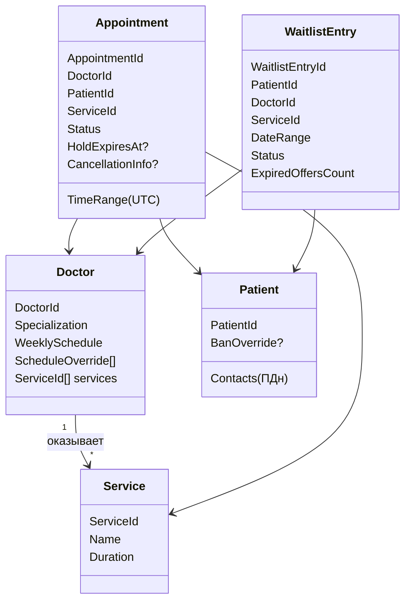
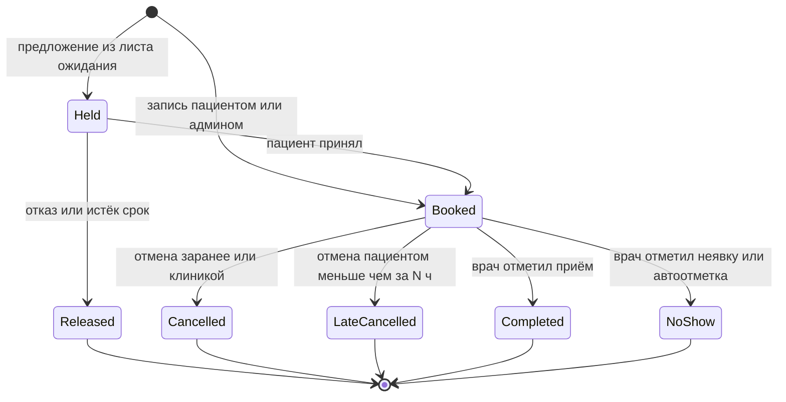

# MedSlot — доменная модель

Документ фиксирует правила предметной области до начала кода. Изменения правил вносятся сюда и, если они архитектурно значимы, оформляются отдельным ADR.

## 1. Глоссарий

| Термин | Значение |
|---|---|
| Клиника | Организация, в которой работают врачи. В системе одна клиника, одна таймзона |
| Врач (`Doctor`) | Специалист с расписанием и набором услуг, которые он оказывает |
| Услуга (`Service`) | Тип приёма с фиксированной длительностью |
| Расписание (`WeeklySchedule`) | Рабочие интервалы врача по дням недели, в локальном времени клиники |
| Исключение (`ScheduleOverride`) | Отклонение от расписания на конкретные даты: отпуск, больничный, изменённые часы. В коде не `ScheduleException`, чтобы не путать с `System.Exception` |
| Шаг сетки | Минимальная единица времени, по которой выравниваются начала слотов |
| Слот | Свободный интервал у врача, в который помещается услуга. Не хранится, вычисляется |
| Запись (`Appointment`) | Факт бронирования интервала времени врача пациентом |
| Удержание (`Held`) | Временная бронь интервала под предложение из листа ожидания |
| Нарушение | Поздняя отмена или неявка пациента |
| Бан | Временный запрет пациенту записываться онлайн |
| Лист ожидания (`WaitlistEntry`) | Заявка пациента на запись, если освободится подходящий интервал |

## 2. Параметры клиники

Все правила параметризованы. Значения по умолчанию:

| Параметр | По умолчанию | Смысл |
|---|---|---|
| `TimeZone` | `Europe/Moscow` | Таймзона клиники (IANA) |
| `SlotGridStep` | 15 мин | Шаг сетки слотов |
| `BookingHorizon` | 60 дней | Насколько вперёд можно записаться |
| `MinBookingLeadTime` | 1 ч | Минимальное время от момента записи до начала приёма |
| `MaxActiveAppointmentsPerPatient` | 5 | Активных будущих записей у пациента |
| `FreeCancellationWindow` (N) | 24 ч | Отмена раньше чем за N часов — без последствий |
| `NoShowAutoMarkDelay` | 2 ч | Через сколько после окончания приёма неотмеченная запись становится `NoShow` |
| `ViolationWindow` | 90 дней | Окно подсчёта нарушений |
| `ViolationsForBan` | 3 | Нарушений в окне для бана |
| `BanDuration` | 30 дней | Длительность бана |
| `WaitlistOfferTtl` | 30 мин | Время на ответ по предложению из листа ожидания |
| `MaxWaitlistEntriesPerPatient` | 3 | Активных заявок в листе ожидания у пациента |
| `MaxExpiredOffersPerEntry` | 2 | После стольких проигнорированных предложений заявка закрывается |

## 3. Агрегаты и границы

- Каждый агрегат меняется в отдельной транзакции, ссылки между агрегатами — только по ID.
- **Исключение:** принятие предложения из листа ожидания меняет `Appointment` (`Held → Booked`) и `WaitlistEntry` (`Offered → Fulfilled`) в одной транзакции. Это осознанный компромисс: иначе пришлось бы строить сагу ради двух строк в одной БД.
- **Межагрегатный инвариант «нет пересечений у врача и у пациента»** гарантирует не домен, а БД — exclusion constraint по `(doctor_id, time_range)` и `(patient_id, time_range)` для активных статусов. Домен делает предварительную проверку для понятной ошибки, но истиной считается constraint.
- Слот — не сущность. Его нет в БД, он вычисляется из расписания и занятых интервалов.

## 4. Время

- Все моменты времени хранятся в UTC (`Instant`, в БД — `timestamptz`).
- Расписание и исключения задаются в локальном времени клиники (`LocalTime`, `LocalDate`).
- Используется NodaTime, текущее время — через порт `IClock`.
- Преобразование локального времени в UTC — `Resolvers.LenientResolver`: несуществующее время (переход на летнее) сдвигается вперёд, неоднозначное (переход на зимнее) берётся по более раннему смещению.
- Следствие: рабочий день при смене времени длится на час больше или меньше, и слоты строятся по реальной оси времени, а не по «настенным часам».

## 5. Расписание и вычисление слотов

### Расписание
- Для каждого дня недели — список непересекающихся рабочих интервалов `[from, to)`. Перерыв — промежуток между интервалами.
- Исключение на дату или диапазон дат: `DayOff` (нет приёма — отпуск, больничный) или `CustomHours` (свои интервалы вместо недельных).
- Если у врача на период исключения уже есть записи, добавить исключение нельзя: команда возвращает конфликт со списком записей. Администратор сначала отменяет их (отмена клиникой, см. §6.3), затем повторяет команду.

### Алгоритм
Для врача, услуги и периода дат:
1. Для каждой даты определить рабочие интервалы: исключение, если есть, иначе недельное расписание.
2. Перевести интервалы в UTC (§4).
3. В каждом интервале перебрать начала с шагом `SlotGridStep` от начала интервала.
4. Кандидат `[start, start + duration)` подходит, если:
   - целиком внутри рабочего интервала;
   - не пересекается с активными записями врача (`Held`, `Booked`);
   - `start ≥ now + MinBookingLeadTime` и `start ≤ now + BookingHorizon`.
5. Врач должен оказывать эту услугу.

Длительность услуги кратна шагу сетки (проверяется при создании услуги).

## 6. Запись (`Appointment`)

### 6.1. Статусы

Активные статусы (занимают время врача и пациента): `Held`, `Booked`. Остальные — терминальные.

Статуса `Confirmed` нет: подтверждать запись некому и незачем, а лишний шаг усложняет модель. Перенос записи — это отмена и новая запись.

### 6.2. Переходы

| Переход | Кто | Условия | Событие |
|---|---|---|---|
| → `Booked` | Пациент | Нет бана; начало попадает в сетку расписания врача; слот свободен и в горизонте; `start ≥ now + MinBookingLeadTime`; активных записей < `MaxActiveAppointmentsPerPatient`; нет пересечений у пациента | `AppointmentBooked` |
| → `Booked` | Админ | То же, кроме бана и лимита активных записей | `AppointmentBooked` |
| → `Held` | Система | См. §8 | `WaitlistSlotOffered` |
| `Held → Booked` | Пациент | `now < HoldExpiresAt` | `WaitlistOfferAccepted`, `AppointmentBooked` |
| `Held → Released` | Пациент / система | Отказ или `now ≥ HoldExpiresAt` | `WaitlistOfferDeclined` / `WaitlistOfferExpired` |
| `Booked → Cancelled` | Пациент | `now ≤ start − N` | `AppointmentCancelled` (`isLate = false`) |
| `Booked → LateCancelled` | Пациент | `start − N < now < start` | `AppointmentCancelled` (`isLate = true`) |
| `Booked → Cancelled` | Врач / админ | `now < start`; указывается причина | `AppointmentCancelled` (`initiatedBy = Clinic`) |
| `Booked → Completed` | Врач | `now ≥ start` | `AppointmentCompleted` |
| `Booked → NoShow` | Врач | `now ≥ start` | `AppointmentNoShow` |
| `Booked → NoShow` | Система | `now ≥ end + NoShowAutoMarkDelay` | `AppointmentNoShow` (`auto = true`) |

- После начала приёма пациент отменить запись не может: она завершается как `Completed` или `NoShow`.
- Граница N часов включительная: отмена ровно за N часов — без последствий.
- Отмена клиникой никогда не считается нарушением пациента.

### 6.3. Отмена клиникой
Используется, когда врач заболел или уходит в отпуск. Запись получает `Cancelled` с `initiatedBy = Clinic`, пациент получает уведомление. В лист ожидания интервал не уходит: врач в это время не принимает.

## 7. Нарушения и бан

- **Нарушение** — запись в статусе `LateCancelled` или `NoShow`. Время нарушения — момент перехода в этот статус.
- Отдельного счётчика нет: нарушения вычисляются запросом по записям пациента. Это исключает рассинхронизацию счётчика и истории.
- **Бан** наступает в момент нарушения `t`, если в окне `(t − ViolationWindow, t]` набралось ≥ `ViolationsForBan` нарушений, и длится до `t + BanDuration`. Окно отсчитывается от нарушения, а не от текущего момента: иначе бан снимался бы досрочно, как только первое из нарушений выйдет из окна. Новое нарушение во время бана, снова набирающее порог, продлевает бан.
- Бан запрещает только **онлайн-запись самим пациентом**. Админ может записать пациента; существующие записи остаются в силе; предложения из листа ожидания забаненный пациент не получает.
- Админ может снять бан досрочно: в `Patient` сохраняется `BanOverride` — нарушения до этого момента не учитываются.

## 8. Лист ожидания

### Заявка
- Пациент указывает врача, услугу и диапазон дат.
- Статусы: `Active → Offered → Fulfilled`; `Active | Offered → Cancelled` (отменил пациент); `Active → Expired` (диапазон дат прошёл или превышен лимит проигнорированных предложений).
- У пациента не больше `MaxWaitlistEntriesPerPatient` активных заявок.

### Предложение
Срабатывает, когда запись переходит в `Cancelled` (по инициативе пациента) или `LateCancelled`, а также при `Held → Released` (отказ, истечение, выход пациента из листа ожидания). Отмена клиникой предложения не создаёт: врач в это время не принимает.

1. Освободившийся интервал `[start, end)`. Если `start − now < WaitlistOfferTtl + MinBookingLeadTime` — предложение не делается, слот остаётся обычным свободным.
2. Кандидаты: заявки `Active` к этому врачу, дата `start` попадает в диапазон, длительность услуги заявки ≤ `end − start`, пациент не забанен и свободен в это время. Заявка, которая только что отказалась от этого интервала или пропустила его, не рассматривается.
3. Выбирается первая по позиции в очереди (`QueuedAt`, FIFO).
4. Создаётся `Appointment` в статусе `Held` на `[start, start + duration заявки)`, `HoldExpiresAt = now + WaitlistOfferTtl` (благодаря шагу 1 это всегда не позже `start − MinBookingLeadTime`). Заявка → `Offered`.
5. Ответ пациента:
   - **принял** → `Held → Booked`, заявка → `Fulfilled`;
   - **отказался** → `Held → Released`, заявка → `Active` и **в конец очереди** (отказ от конкретного времени не отменяет заявку);
   - **не ответил** → `Held → Released`, заявка → `Active` и в конец очереди, `ExpiredOffersCount++`; при достижении `MaxExpiredOffersPerEntry` заявка → `Expired`.
6. После `Released` интервал снова проходит шаг 1 со следующим кандидатом.

Пока интервал в `Held`, забронировать его никто другой не может: `Held` — активный статус и попадает под exclusion constraint.

**Атомарность.** Освобождение интервала и удержание для следующего кандидата сохраняются одной транзакцией. Обычная запись не может перехватить время между этими шагами: новые записи врача сериализуются его advisory-блокировкой (ADR 0005). Если кандидат в ту же миллисекунду записался на это время в другом месте, constraint пациента отклонит транзакцию целиком, и клиент получит `409 concurrent_modification`. При повторе кандидат уже не пройдёт проверку занятости.

**Истечение.** Фоновая служба раз в 15 секунд снимает просроченные удержания по одному, каждое в своей транзакции, и закрывает заявки с прошедшим диапазоном дат. Гонку «принял в последнюю секунду» и «истекло» разрешает оптимистичная блокировка (`xmin`) записи и заявки: побеждает тот, кто сохранил первым, второй получает конфликт.

## 9. Доменные события

Топик `appointments`, ключ сообщения — `doctorId`. В событиях **только идентификаторы и время**, без персональных данных.

Общий конверт: `eventId`, `eventType`, `schemaVersion`, `occurredAt`, `aggregateId`, `doctorId`, `traceparent`, `payload`. Схемы — в проекте `MedSlot.Contracts` (ADR 0008).

| Событие | Payload |
|---|---|
| `AppointmentBooked` | `appointmentId`, `patientId`, `serviceId`, `startsAt`, `endsAt`, `bookedBy` (`Patient` / `Admin` / `Waitlist`) |
| `AppointmentCancelled` | `appointmentId`, `patientId`, `startsAt`, `initiatedBy` (`Patient` / `Clinic`), `isLate`, `reasonCode` |
| `AppointmentCompleted` | `appointmentId`, `patientId` |
| `AppointmentNoShow` | `appointmentId`, `patientId`, `auto` |
| `WaitlistSlotOffered` | `waitlistEntryId`, `appointmentId`, `patientId`, `startsAt`, `endsAt`, `expiresAt` |
| `WaitlistOfferAccepted` | `waitlistEntryId`, `appointmentId`, `patientId` |
| `WaitlistOfferDeclined` | `waitlistEntryId`, `appointmentId`, `patientId` |
| `WaitlistOfferExpired` | `waitlistEntryId`, `appointmentId`, `patientId` |

## 10. Роли и права

| Действие | Patient | Doctor | Admin |
|---|---|---|---|
| Смотреть врачей, услуги, слоты | ✓ | ✓ | ✓ |
| Записаться / отменить свою запись | ✓ (без бана) | — | — |
| Записать / отменить запись любого пациента | — | — | ✓ |
| Отменить запись к себе (клиника) | — | ✓ | ✓ |
| Отметить `Completed` / `NoShow` | — | ✓ (свои приёмы) | ✓ |
| Лист ожидания: свои заявки, ответ на предложение | ✓ | — | — |
| Управлять расписанием и исключениями | — | смотреть своё | ✓ |
| Смотреть карточку пациента | свою | своих пациентов (с записью в журнал доступа) | ✓ (с записью в журнал) |
| Снять бан | — | — | ✓ |

## 11. Вне рамок проекта

- Несколько клиник, филиалов, таймзон.
- Оплата, страховки, медицинские данные (диагнозы, назначения).
- Кабинеты и оборудование как ресурсы.
- Групповые приёмы.
- Перенос записи как отдельная операция.
- Смены врача через полночь: рабочий интервал всегда в пределах одних суток.
